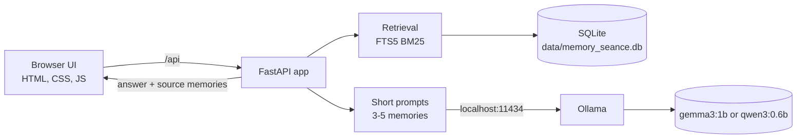
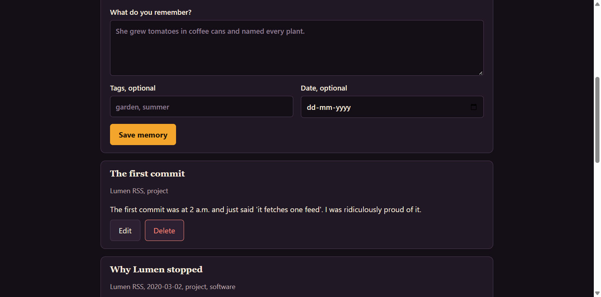
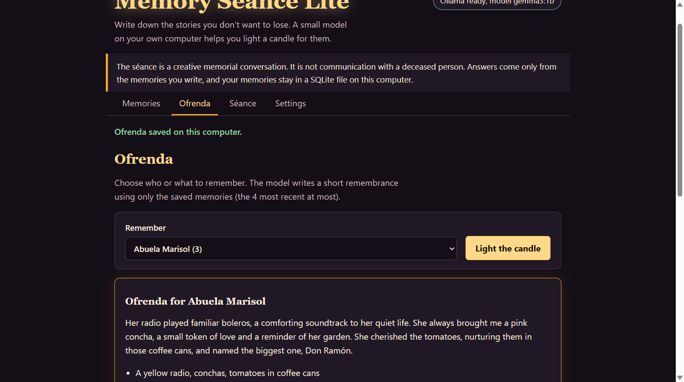
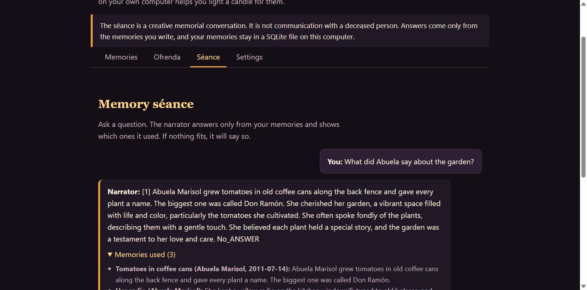
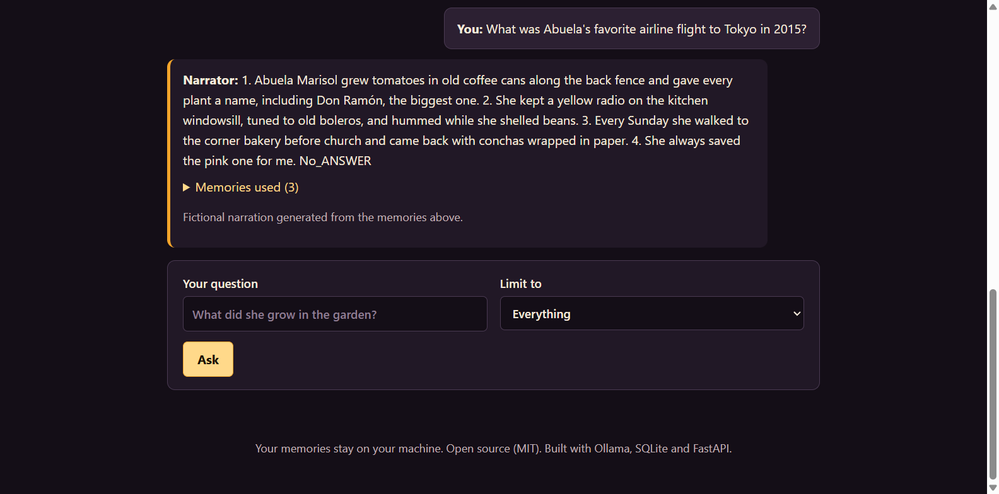

# Memory Séance Lite

A private, local-first memorial app: save short memories of a person, pet, place, or abandoned project, and let a small open-weight model on your own computer write an ofrenda and answer questions, using only what you wrote.


> **The séance is a creative memorial conversation. It is not communication with a deceased person.** The narrator is a small language model that only retells the memories you wrote.

## Why this exists

Grief, nostalgia and half-forgotten projects are some of the most private things we write down, and they are exactly what you should not upload to a hosted AI service. Memory Séance Lite keeps the whole loop on your computer: SQLite for storage, Ollama for inference, and a model small enough for an old laptop.

## The "Ghost in the Machine" theme

Built for the DEV Hacktoberfest Open-Source AI Challenge, Week 4: *Ghost in the Machine*. The "ghost" here is not a haunting. It is the trace people and abandoned projects leave behind, rendered through the warm, respectful lens of Día de los Muertos: an ofrenda lit with candles and marigolds rather than a horror story. The machine is a small local model that speaks only from what you remember, and says so when it cannot.

## Features

- Add, edit, list and delete memories (title, person/project, text, optional tags and date).
- **Ofrenda:** a short remembrance paragraph, three "things remembered" and a Día de los Muertos closing line. Saved locally.
- **Memory séance chat:** answers only from retrieved memories, always shows which memories were used, and refuses when nothing relevant exists.
- Retrieval with SQLite FTS5 (BM25), no embedding model. Only 3 to 5 memories go into the prompt.
- Model switch in the UI or `.env`: `gemma3:1b` (default) or `qwen3:0.6b` for very low-resource machines.
- "Delete all memories" wipes the database and compacts the file.
- Accessible, responsive, dark marigold-and-candle theme. No frameworks, no build step, no external fonts.
- Works offline after setup.

## Architecture



**Why FastAPI?** Python's standard library already provides SQLite (with FTS5 in nearly all builds), so the whole backend needs only three small packages: `fastapi`, `uvicorn` and `httpx`. No Node toolchain, no `node_modules`, and request validation comes built in.

### Resource & Disk Optimization Practices
- **SQLite Performance & Footprint**:
  - `PRAGMA journal_mode=WAL` with `synchronous=NORMAL`: Concurrent reads without lock contention, eliminating write stalls while protecting data integrity.
  - `PRAGMA cache_size=-2000`: Strict ~2MB page cache cap to prevent uncontrolled memory inflation on tiny machines.
  - `PRAGMA temp_store=MEMORY`: Keeps ephemeral sorts and search tables in RAM to reduce disk churn and SSD write wear.
  - Automatic `VACUUM` compaction on data deletion to reclaim disk space immediately.
- **Model Memory Management**:
  - `keep_alive="5m"`: Automatically unloads the model from RAM/VRAM after 5 minutes of inactivity so your background memory is returned to the OS.
  - Bounded context window (`num_ctx=2048`) and batching (`num_batch=128`): Bounds KV cache allocations and peak evaluation RAM.
- **Multi-Tier Fallbacks**:
  - **Retrieval Fallback**: Automatically tries SQLite FTS5 BM25 ranked search; if FTS5 is not compiled into the local SQLite build, cleanly falls back to pure-Python token/stemming scoring without failing.
  - **Model Architecture Fallback**: Seamlessly supports ultra-lightweight models (such as `qwen3:0.6b` or `qwen2.5:1.5b`) with reasoning traces disabled (`think=False`) for CPU-only systems.
  - **Structured Generation Fallback**: Dual-attempt retry on JSON generation for tiny models, with markdown/sub-string extraction fallback if the model outputs conversational preamble.

## Demo Video

Watch the walkthrough on YouTube: **[https://youtu.be/PM4JgmZCKf8](https://youtu.be/PM4JgmZCKf8)**

## Screenshots


*List of sample memorial entries and metadata.*


*AI-generated Ofrenda for Abuela Marisol using offline Gemma 3 1B.*


*Séance answer with retrieved memories and citation grounding.*


*Honest refusal when asked questions outside the remembered context.*

## Prerequisites

- Python 3.10 or newer
- [Ollama](https://ollama.com/download)
- About 1 GB of free disk for `gemma3:1b` (less for `qwen3:0.6b`) and a few GB of free RAM. No GPU needed.

## Installation

**1. Install Ollama** from <https://ollama.com/download> (Windows installer, macOS app, or on Linux `curl -fsSL https://ollama.com/install.sh | sh`). Make sure it is running.

**2. Clone and set up**

macOS / Linux:
```bash
git clone <YOUR-REPO-URL> memory-seance-lite && cd memory-seance-lite
./scripts/setup.sh            # add --low for qwen3:0.6b
```

Windows (PowerShell):
```powershell
git clone <YOUR-REPO-URL> memory-seance-lite; cd memory-seance-lite
.\scripts\setup.ps1           # add -Low for qwen3:0.6b
```

The scripts create `.venv`, install the three dependencies, copy `.env.example` to `.env`, and run `ollama pull` for the model. Manual equivalent:

```bash
python -m venv .venv && source .venv/bin/activate     # Windows: .venv\Scripts\activate
pip install -r requirements.txt
ollama pull gemma3:1b
```

## Run

```bash
python -m app.main                                         # production-like, single command
uvicorn app.main:create_app --factory --reload             # development, auto-reload
```

Open <http://127.0.0.1:8000>. To try it with fictional data: `python scripts/load_sample.py`.

## Configuration

Set values in `.env` or as environment variables.

| Variable | Default | Meaning |
|---|---|---|
| `MSL_MODEL` | `gemma3:1b` | Ollama model name |
| `OLLAMA_BASE_URL` | `http://localhost:11434` | Where Ollama listens |
| `MSL_HOST` / `MSL_PORT` | `127.0.0.1` / `8000` | Keep the host on localhost |
| `MSL_DB_PATH` | `data/memory_seance.db` | SQLite file |
| `MSL_TOP_K` | `4` | Memories per request (clamped to 3-5) |
| `MSL_TIMEOUT` | `120` | Seconds to wait for the model |

The Settings tab can also change the model and URL; those choices are stored in the database and override `.env`.

## Low-resource mode

```bash
ollama pull qwen3:0.6b
```
Then choose `qwen3:0.6b` in Settings, or set `MSL_MODEL=qwen3:0.6b` in `.env` (or run `./scripts/setup.sh --low`). The app turns off qwen3's "thinking" output to save time, and prompts are kept short with `num_ctx` of 2048. Lower `MSL_TOP_K` to 3 for even less memory use. Very small models can write clumsy sentences; the app retries once on broken output and never invents an answer when no memory matches.

## Privacy and data storage

- Everything lives in one SQLite file, `data/memory_seance.db`. `data/` is git-ignored.
- The server binds to `127.0.0.1` and sets a strict Content-Security-Policy; the page loads no external scripts, fonts, or analytics.
- The only network call the app makes is to your configured Ollama URL (localhost by default).
- **Delete all memories** (Settings tab, or `DELETE /api/data?confirm=yes`) removes every memory and ofrenda and compacts the file. You can also just delete the `data/` file.

## No cloud, no paid API

No API keys, hosted model providers, paid services, Docker, GPU, audio or photos are needed. After the initial Ollama and model download, the app works offline.

## Troubleshooting

| Symptom | Fix |
|---|---|
| Header says "Cannot reach Ollama" | Start Ollama (open the app, or `ollama serve`). Check the URL in Settings. |
| "Model ... is not installed" | Run `ollama pull gemma3:1b` (or the model shown). |
| Very slow or timeouts | Switch to `qwen3:0.6b`, close other apps, raise `MSL_TIMEOUT`. The first request loads the model and is slowest. |
| "The model did not return a usable ofrenda" | Try again; small models occasionally break JSON. Try a different model. |
| Séance says it can't answer | Working as intended: no saved memory matches. Add one, or use words that appear in your memories (search is keyword-based). |
| Port in use | Set `MSL_PORT` in `.env`. |

## API

All routes are under `/api`; interactive docs at `/docs`.

| Method | Path | Purpose |
|---|---|---|
| GET | `/health` | Ollama status, model installed?, memory count |
| GET / PUT | `/settings` | Read / change model and Ollama URL |
| GET / POST | `/memories` | List (optional `?subject=`) / create |
| PUT / DELETE | `/memories/{id}` | Edit / delete |
| GET | `/subjects` | Distinct people/projects with counts |
| POST | `/ofrenda` | `{subject}` generate and save an ofrenda |
| GET / DELETE | `/ofrendas`, `/ofrendas/{id}` | List / delete saved ofrendas |
| POST | `/seance` | `{question, subject?}` returns `answered`, `answer`, `sources`, `disclaimer` |
| DELETE | `/data?confirm=yes` | Delete all memories and ofrendas |

Errors use `{"detail": {"code", "message"}}` with codes such as `ollama_unavailable` (503), `model_missing` (409), `llm_bad_output` (502), `llm_timeout` (504), `no_memories` (404).

## Tests

```bash
pip install -r requirements-dev.txt
ruff check . && pytest -q
```
Tests use a temporary SQLite file and mock every LLM call, so they need no Ollama and finish in about a second. CI (`.github/workflows/ci.yml`) runs them on Python 3.10 and 3.12. `demo.yml` is a manual workflow that publishes a Markdown build report; it deliberately never runs a real model.

## Project structure

```
app/            main.py (app factory), routes.py (API), database.py (SQLite + FTS5),
                retrieval.py (BM25 / fallback), llm.py (Ollama client), prompts.py, config.py
static/         css/style.css, js/app.js (vanilla JS, no build step)
templates/      index.html
scripts/        setup.sh, setup.ps1, load_sample.py, build_report.py
tests/          pytest suite (LLM mocked)
docs/           demo-script.md, screenshots.md, sample-memories.json  (dev-post.md is a git-ignored local draft)
data/           your private database (git-ignored)
```

## Roadmap

- Export / import memories as JSON
- UI translations (Spanish first)
- Optional tiny local embeddings, only if a genuinely small model fits
- Printable ofrenda cards

## Contributing

See [CONTRIBUTING.md](CONTRIBUTING.md). In short: keep it small, local, and kind.

## License

MIT. See [LICENSE](LICENSE). Model weights have their own licenses (below).

## Acknowledgments

[Ollama](https://ollama.com) (MIT) for local inference; Google's Gemma 3 (open weights under the [Gemma Terms of Use](https://ai.google.dev/gemma/terms), not an OSI license) and Alibaba's Qwen3 (Apache-2.0); [SQLite](https://sqlite.org) (public domain) and its FTS5 extension; [FastAPI](https://fastapi.tiangolo.com), [Uvicorn](https://www.uvicorn.org), [HTTPX](https://www.python-httpx.org), [pytest](https://pytest.org) and [Ruff](https://docs.astral.sh/ruff/). The Día de los Muertos tradition inspired the ofrenda format; this app is a respectful nod to it, not a representation of it.
